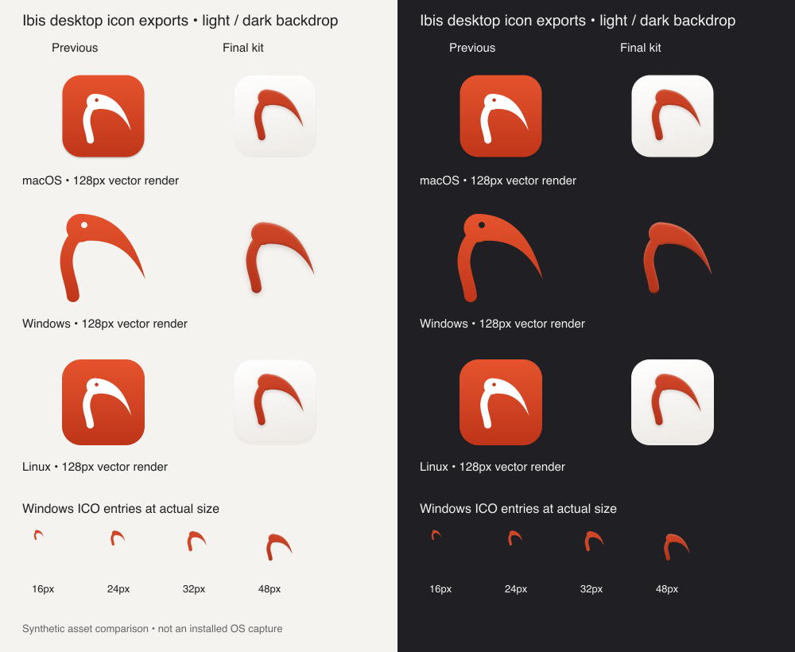

# Desktop icon comparison

Source: `8b3cdda772b974519327d8842fedd510b4f60a59` (#1001). Before: `3421b61c91f58f801e685fb9db0e2c02e87c80b6`.

These are synthetic vector/asset renders, not installed operating-system captures. The Windows small examples use the PNG payloads extracted from the generated ICO at actual size. Larger comparisons render platform SVGs at 128px. macOS retains the 824/1024 face, Windows keeps a transparent background and Linux retains the GNOME profile.

Checks passed: 21 focused asset/shelf/notice tests; deterministic repeat generation; SVG parsing and valid/resolved IDs; ICO and ICNS payload boundaries; Windows nonzero pixels clear of every canvas edge at 16/24/32/48/256px; macOS edge transparency; Apple iconutil decode.

Installed Dock, taskbar, launcher, tray scaling, Windows display-scale alignment and layered macOS delivery were not tested. No personal libraries, messages or screenshots are included.
