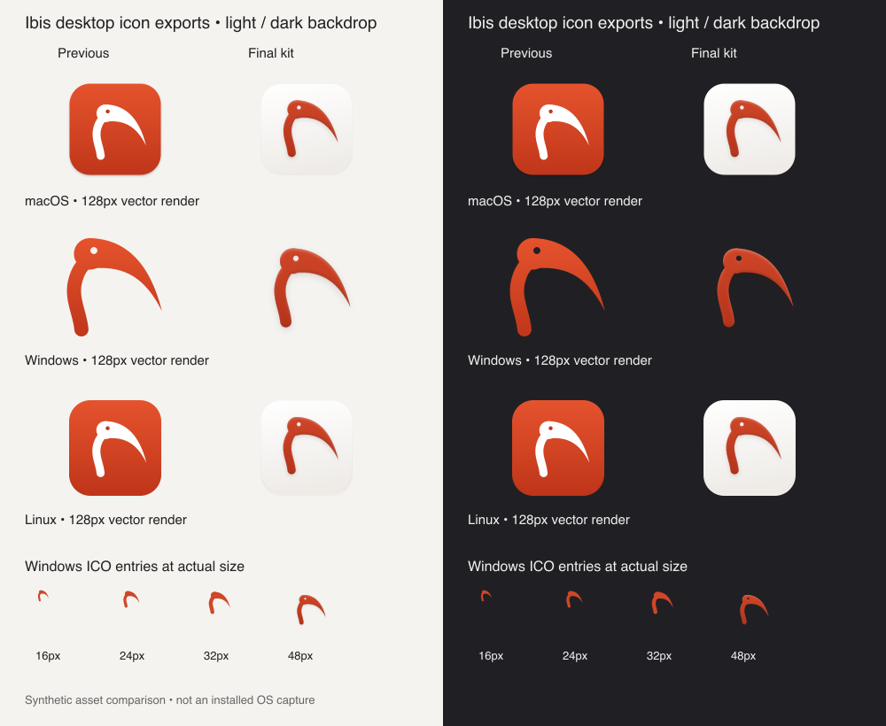

# Desktop brand comparison

Synthetic artwork for PR #1001, source commit `c63137f656fad9c74b64b2eaf20396a14879b7c7`. Before: the previous committed platform SVGs, unchanged between main `3421b61c91f58f801e685fb9db0e2c02e87c80b6` and corrected-kit main `520e636aef3e466cd975e0bcbb5d25659f838bee`. After: the generated current platform SVGs. Both use librsvg at 128 px; bottom rows show actual 16, 24, 32 and 48 px ICO payloads.

Visual inspection passed on light and dark: restored eye at large sizes, no eye below 48 px, clear shadow/padding edges. All five ICO payloads and eleven ICNS payloads match their source renders; Linux sizes, unique SVG IDs and Apple iconutil decoding passed. The eye remains transparent beneath the approved faint inset shade.

These are asset renders, not installed OS shell screenshots. Installed shell/DPI acceptance was not run.

The font-backend correction affects only seven text-bearing brand cards. Desktop assets and this comparison are unchanged; the current head was re-rendered and inspected again.
