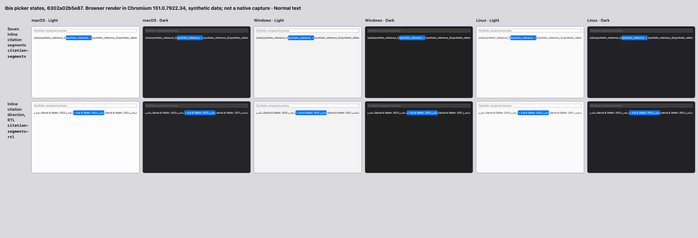
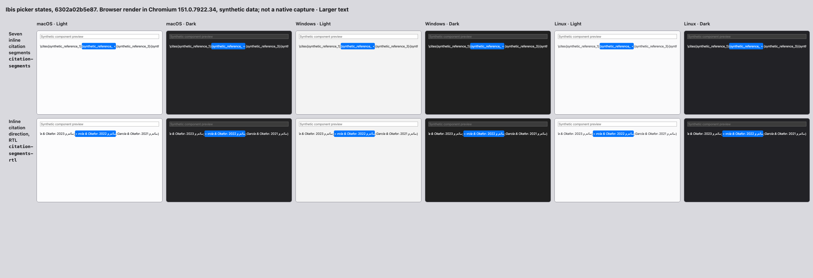

# Inline citation controls — browser evidence

Source: `6302a02b5e87783e516d2b3c06f7b5053371d94d` (#1038, draft). Synthetic data only.

Chromium Chromium 151.0.7922.34, 720×480, scale 1. Two component states, three platform looks, light/dark and normal/Larger text: 24 of 24 rendered. Gallery readiness checks retain seven references, horizontal overflow, a keyboard step in rendered direction, and remove targets within their own pills with no overlap, including zero-separator commands.

These are browser renders, not native appearance or full C7/C8 acceptance. Shelf/footer integration, narrow/coarse/forced-color checks, independent review and native-app checks remain.

