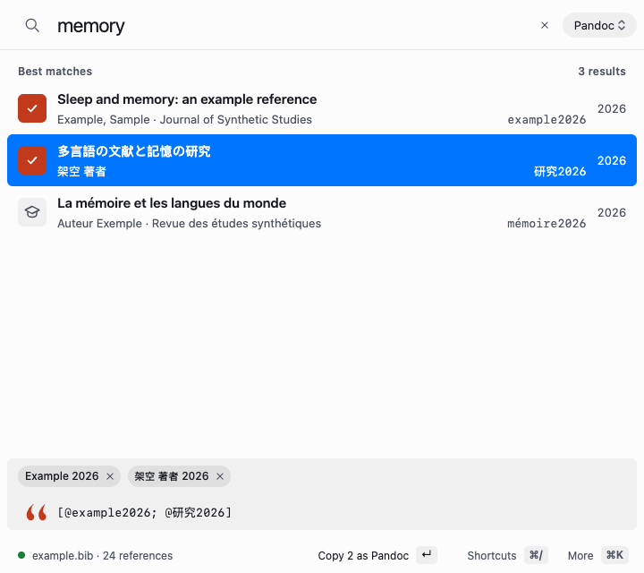
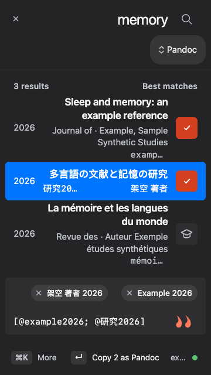
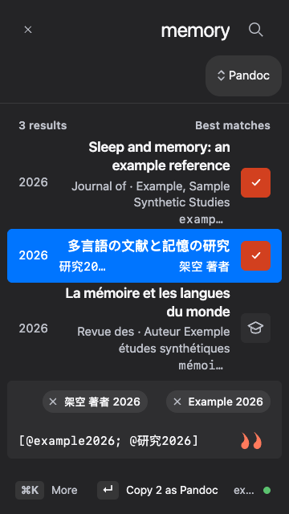
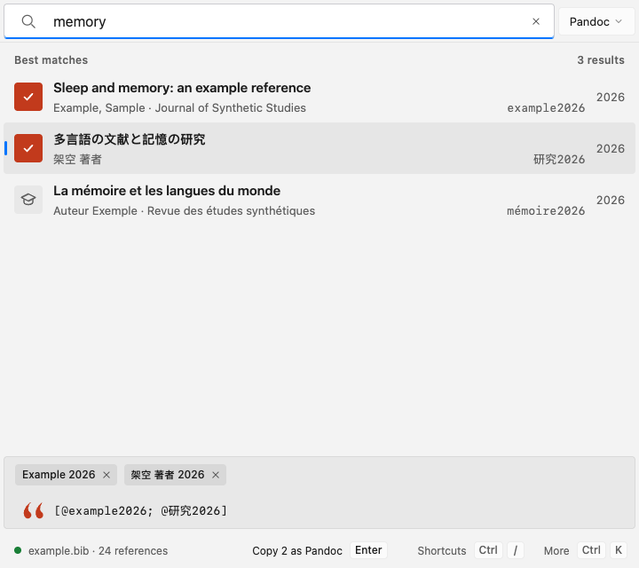
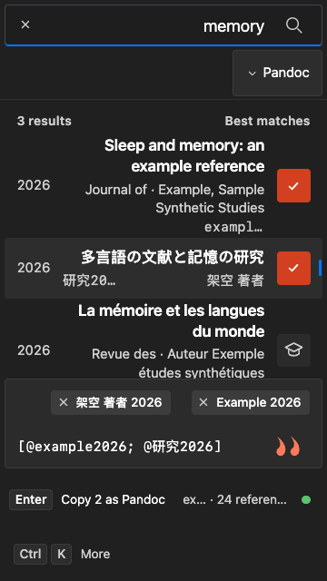
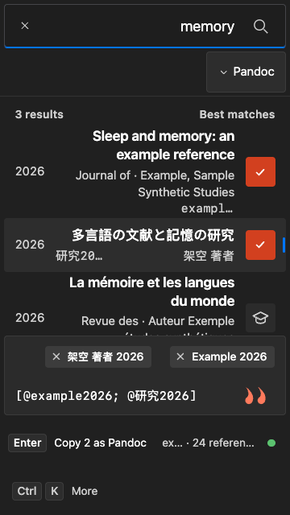
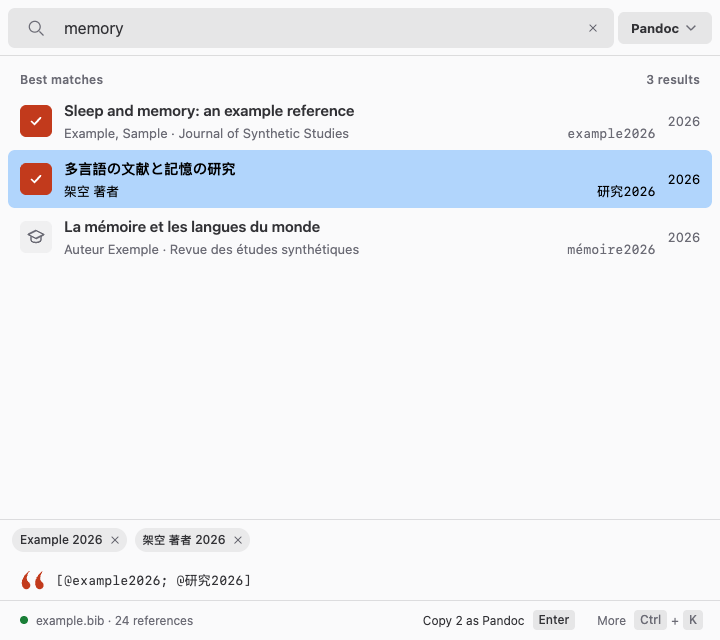
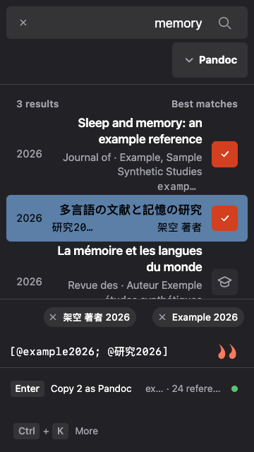
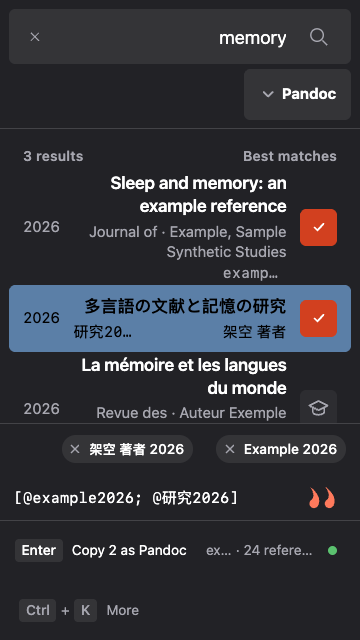

# Search Clear comparison

Synthetic browser evidence for PR #990. Before: `0078af4e9ef77f90f161ffc7f3d2bdae691a9eed`; after: `196f25e609be4f73ce99cf61c9dd6ef3344b6bd1`. Each version was served from an isolated checkout of that exact commit.

All frames are Chrome on macOS rendering Ibis's macOS, Windows and Linux appearance variants, selected before loading. These are browser captures, not native OS screenshots. Both versions use the same existing synthetic selected-citation gallery fixture and retain Search focus with the pointer outside the controls.

Light frames: 720 × 640 CSS pixels, normal text, fine pointer and LTR. Dark frames: 360 × 640 CSS pixels, Larger text (1.15×), coarse-pointer/touch emulation and RTL. All titles, authors and filenames are synthetic.

The shared Clear target is 32 CSS pixels, or 44 for coarse pointers, scaled with Larger text. The field keeps the target inside its boundary and reserves its editing space when the query is empty. Windows/Linux native builds and macOS native interaction observations are recorded separately in the pull request; these images do not claim Windows/Linux manual acceptance.

| Appearance and view | Before | After |
| --- | --- | --- |
| macos · light-normal-fine-ltr |  |  |
| macos · dark-large-coarse-rtl |  |  |
| windows · light-normal-fine-ltr |  |  |
| windows · dark-large-coarse-rtl |  |  |
| linux · light-normal-fine-ltr |  |  |
| linux · dark-large-coarse-rtl |  |  |
