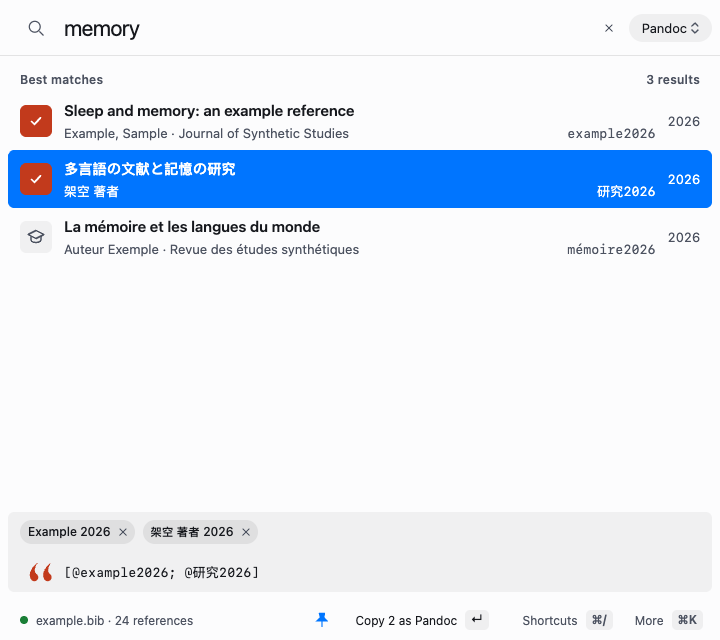
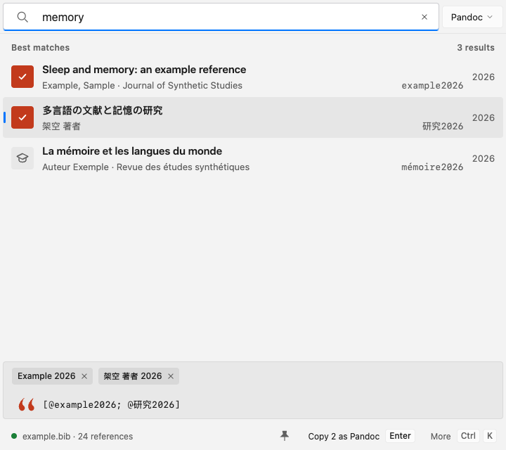
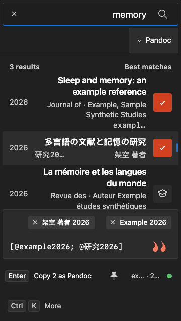
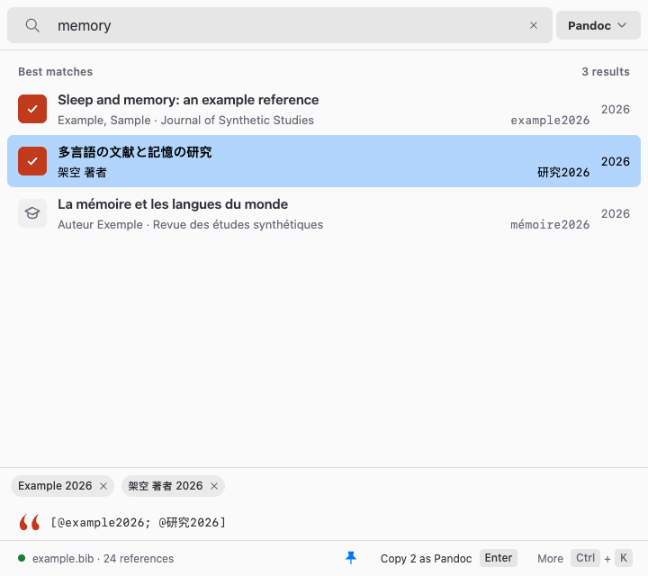
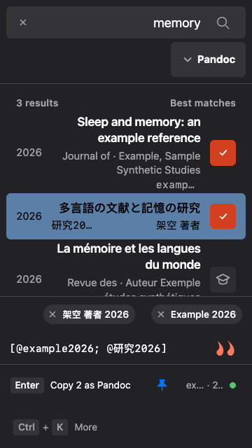
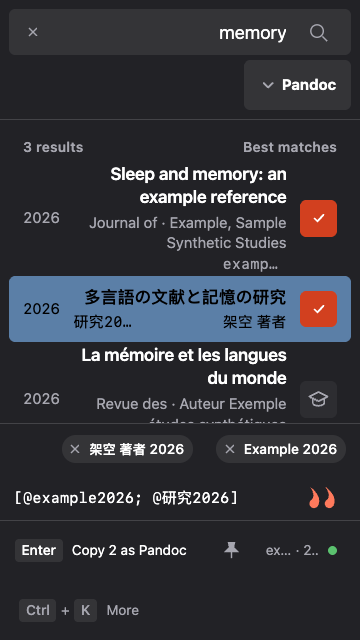

# Footer unpin comparison

Synthetic browser evidence for PR #992. Before: `89803acbed4685ad66ca1df4680988565ba4e3a9`; after: `2c40949d6c3003fbda2de4019922fc02ebe7750d`. Each version was served from an isolated checkout of that exact commit.

All frames are Chrome on macOS rendering Ibis's macOS, Windows and Linux appearance variants, selected before loading. These are browser captures, not native OS screenshots. Both versions use the same synthetic selected-citation gallery fixture with a kept-open picker, Search focus and the pointer outside the controls.

Light frames: 720 × 640 CSS pixels, normal text, fine pointer and LTR. Dark frames: 360 × 640 CSS pixels, Larger text (1.15×), coarse-pointer/touch emulation and RTL. Every title, author and filename is synthetic.

The shared unpin action keeps its footer location and accessible name while using neutral icon states and 32/44 px fine/coarse targets, scaled with Larger text. Keyboard/pointer actions, immediate typing, query/caret preservation, fitting and forced colors were verified separately. The lead recorded macOS native interaction on the pull request; these browser images do not claim Windows/Linux manual acceptance.

| Appearance and view | Before | After |
| --- | --- | --- |
| macos · light-normal-fine-ltr |  |  |
| macos · dark-large-coarse-rtl |  |  |
| windows · light-normal-fine-ltr |  |  |
| windows · dark-large-coarse-rtl |  |  |
| linux · light-normal-fine-ltr |  |  |
| linux · dark-large-coarse-rtl |  |  |
