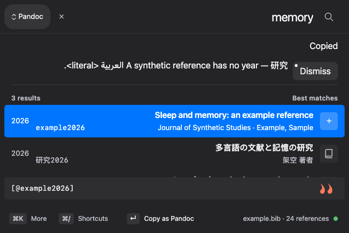
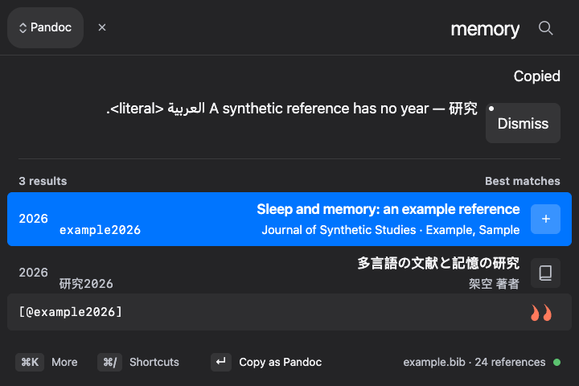
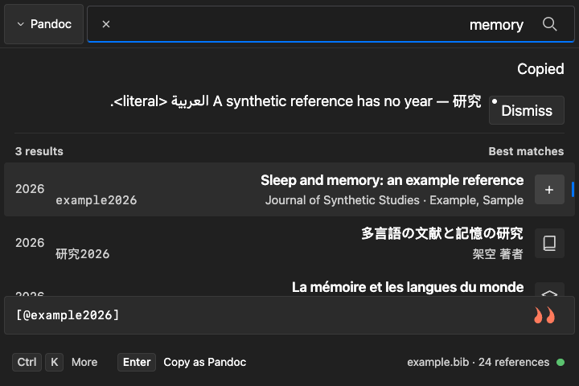
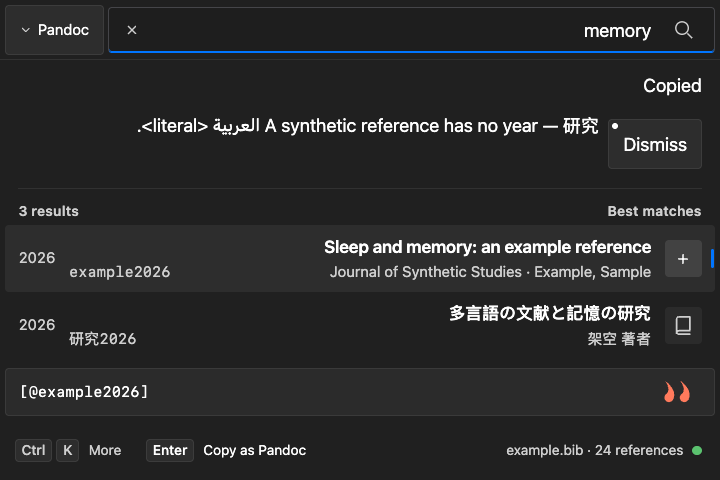
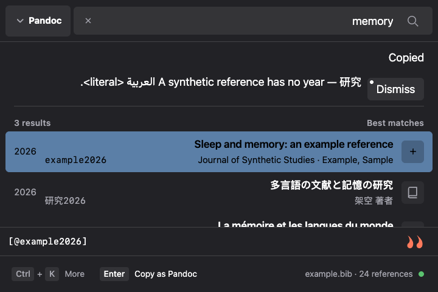
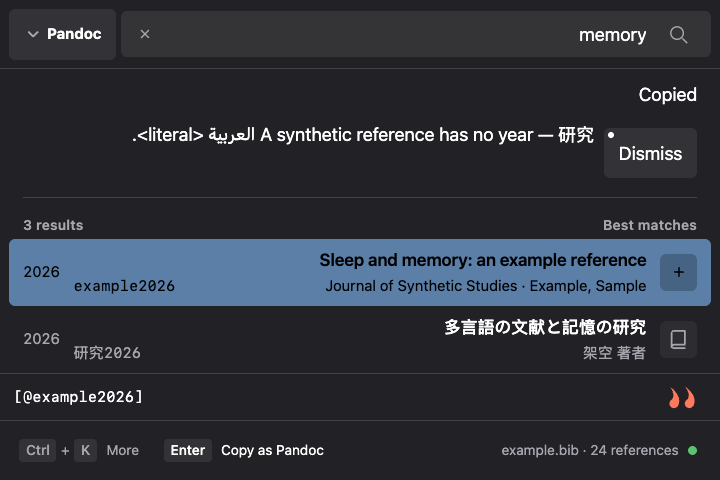

# Copy-warning button comparison

Synthetic browser evidence for PR #986. Before: `d6ee9dc3280aba789d7d4bf5a640def6859075b0`; after: `31c69891acc8548f8b0413c9d796469cc9535e6f`.

All six frames were captured in Chrome on macOS at 720 × 480 CSS pixels, dark theme, Larger text (1.15×), coarse-pointer/touch emulation and document RTL. The named platforms are Ibis appearance variants selected before loading; these are browser renders, not native OS screenshots. Both versions render the same synthetic mixed-script copy-warning fixture through the existing gallery provider API. No private library data appears.

The final button uses the shared secondary states and remains inside the warning notice at the coarse target size. The RTL list marker beside the physical right float is inherited in both versions; these captures do not claim to repair that layout detail. Native acceptance is recorded separately in the pull request.

| Appearance | Before | After |
| --- | --- | --- |
| macOS |  |  |
| Windows |  |  |
| Linux |  |  |
