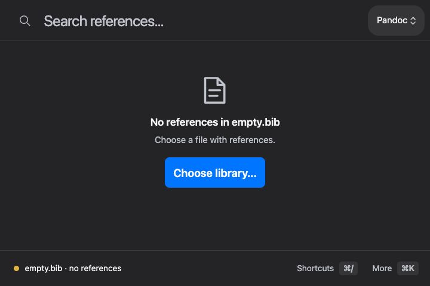
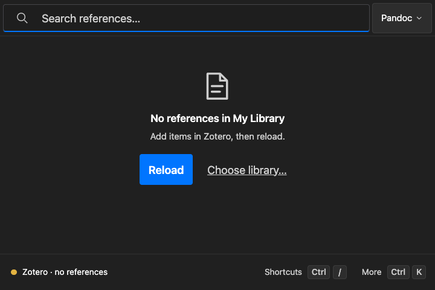
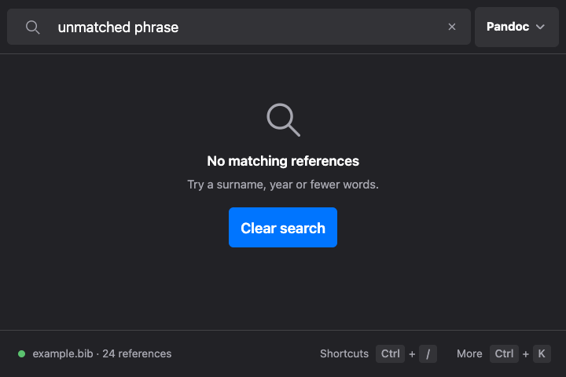

# Empty-state browser evidence

Source: `33396ea9b4b98377c46f5cb80933072cecbabf28` (PR #981).

Three representative final frames from the independent synthetic browser review:
macOS look / empty file, Windows look / empty Zotero library, and Linux look /
no search results. Captured in Chrome on macOS at 720 × 480, dark theme,
picker Larger text (1.15×), with coarse-pointer/touch emulation. The platform
switch was set before page load. The independent review recorded 72 cases;
these three images are a representative subset, not the complete matrix.

These are browser renderings of the three looks. They do not establish native
keyboard delivery, system materials, screen-reader speech or installed acceptance.
All names and library content are synthetic. Native acceptance is recorded
separately in the pull request.

