# Header pin, off and on

Synthetic browser comparison for PR #891. Baseline: `605538cb2e096f397d4dcb166f8fdeda28392ded`; candidate: `5ae1bdd713f62f642fc24ffb53f40595ab7e9e3e`. Both versions render the existing synthetic two-reference tray fixture through the real App and gallery renderer, using synthetic providers only.

Every image is Chrome on macOS displaying the named Ibis appearance variant, selected before load. These are browser captures, not native macOS/Windows/Linux screenshots or custom-accent-provider acceptance. No personal library, OS preference or native command is used. The baseline's already-locked react-aria 3.53.1 transitive package was resolved by a private Vite alias because its dependency directory lacked the direct link; no package was installed or changed.

Light comparisons use 720 × 640 CSS pixels, normal text, fine pointer and LTR. Dark comparisons use 360 × 640, Larger text (1.15×), coarse-pointer/touch emulation and RTL. The pointer rests outside the pin and Search has focus. The pin is captured both off and on, with the same query and selected references.

All 18 browser cases passed: 12 normal interaction/geometry cases across three looks, light/dark and the two size/input combinations, plus six forced-color state cases. The always-visible header toggle follows the format control, uses a filled glyph on a neutral pressed fill when selected, and has no footer duplicate. Pin bounds stay fixed across state changes; search glyph bounds and query start match the baseline, with no horizontal overflow. Fine/coarse targets meet 32/44 px scaled with text and own all four edge probes.

Pointer, held Enter/Space, shortcut repeat suppression, immediate Search typing, retained citations and ordered optimistic native-request simulation passed. More retains its checked action and changes between Keep window open and Stop keeping open; Escape never changes the pin. Forced-color keyboard focus remains visible. Native interaction, actual window pinning and system-accent following are separate acceptance gates.

| Appearance, view and pin state | Before | Candidate |
| --- | --- | --- |
| macos · light · normal-fine-ltr · off | 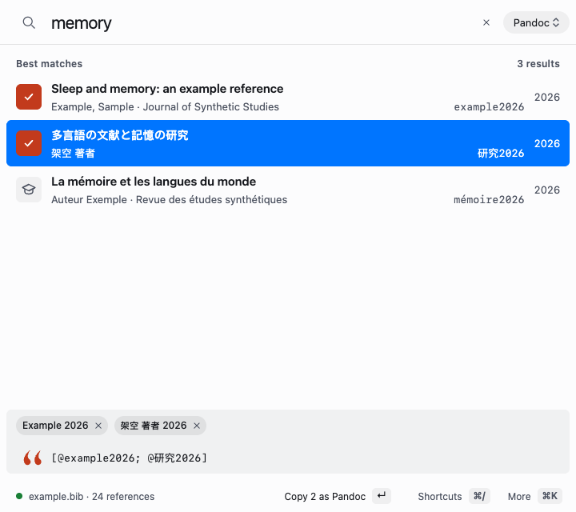 | 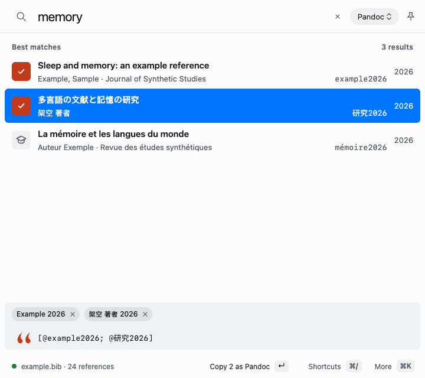 |
| macos · light · normal-fine-ltr · on | 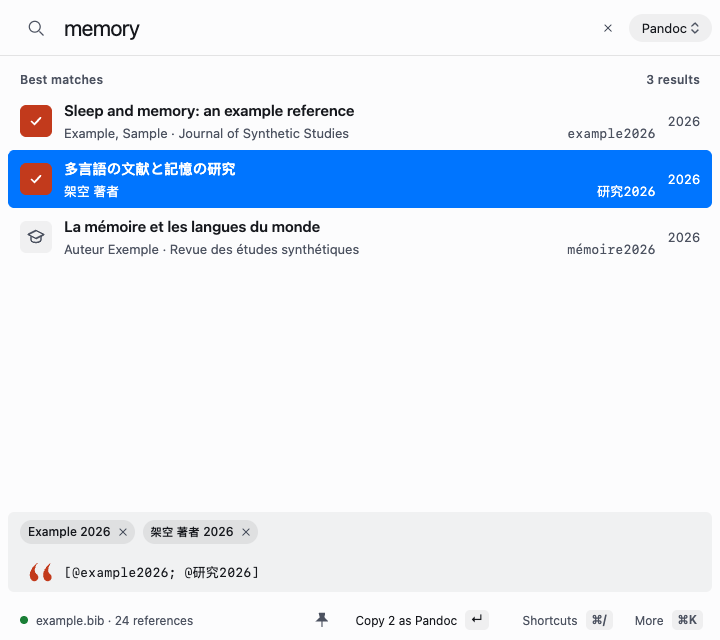 | 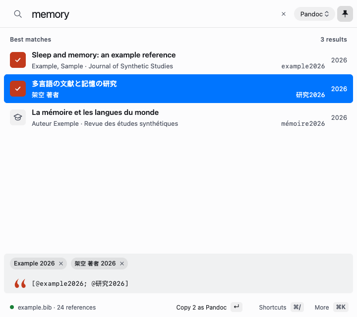 |
| macos · dark · larger-coarse-rtl · off | 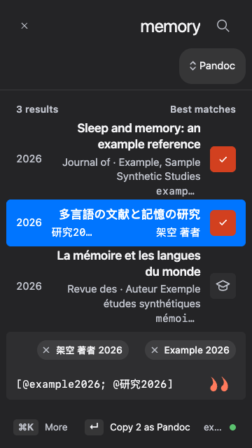 | 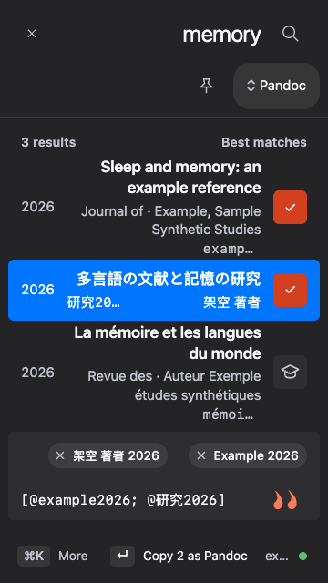 |
| macos · dark · larger-coarse-rtl · on | 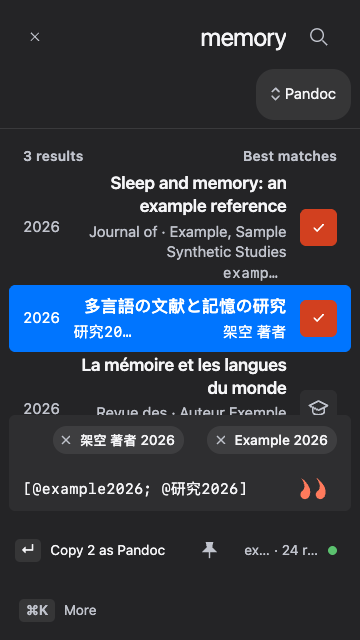 | 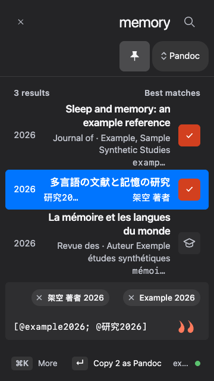 |
| windows · light · normal-fine-ltr · off | 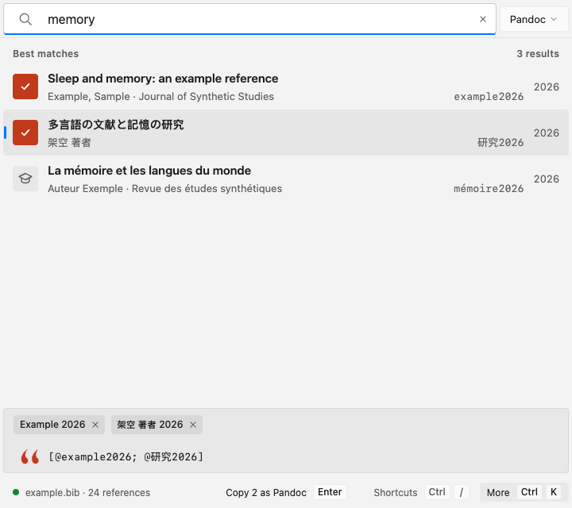 | 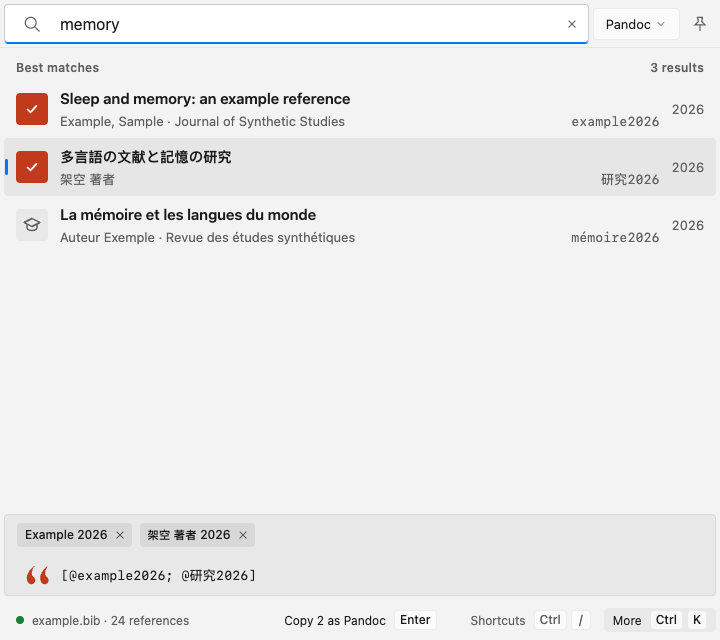 |
| windows · light · normal-fine-ltr · on | 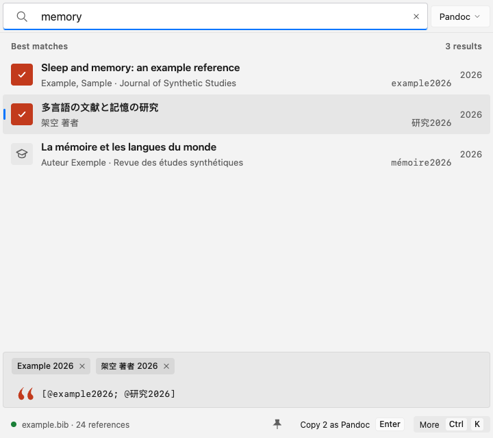 |  |
| windows · dark · larger-coarse-rtl · off | 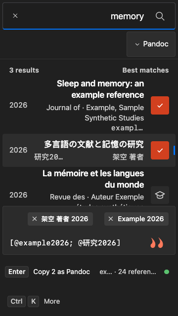 | 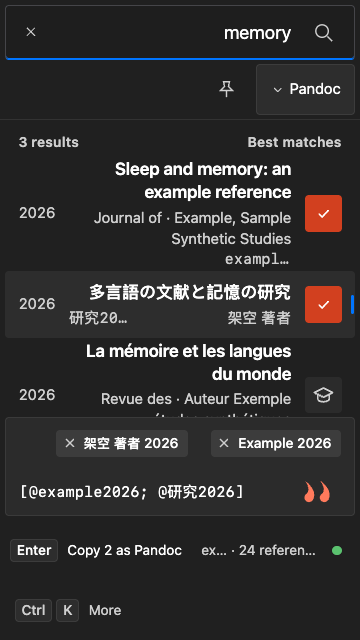 |
| windows · dark · larger-coarse-rtl · on | 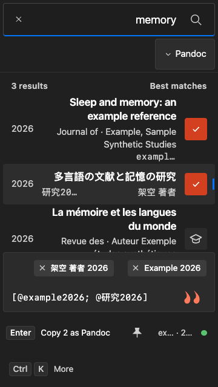 | 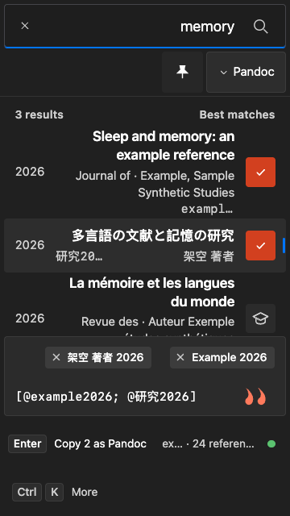 |
| linux · light · normal-fine-ltr · off |  | 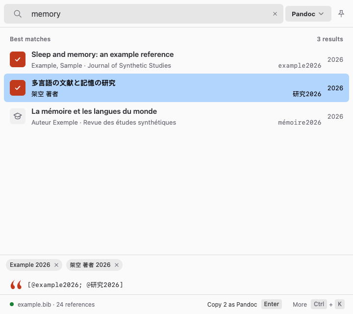 |
| linux · light · normal-fine-ltr · on | 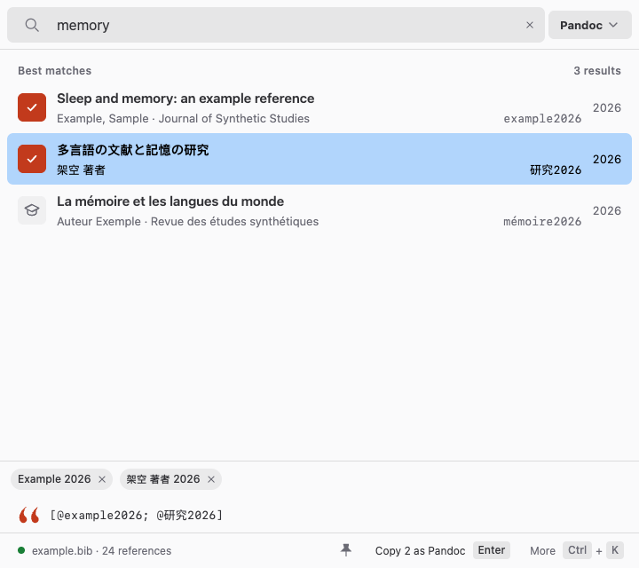 | 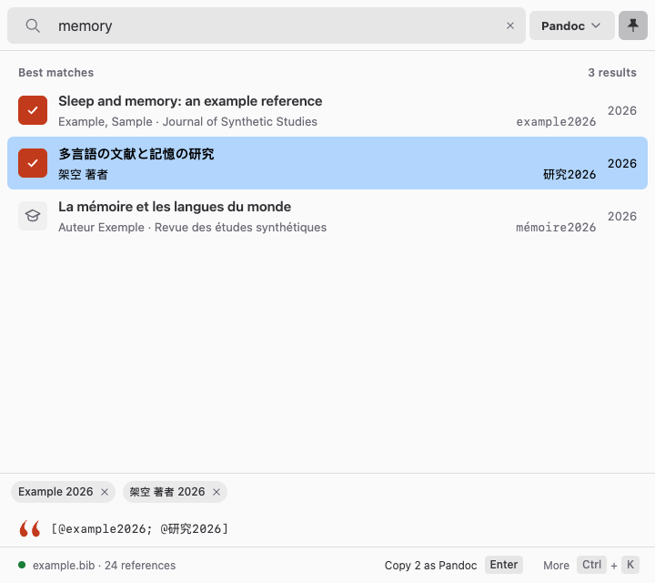 |
| linux · dark · larger-coarse-rtl · off |  | 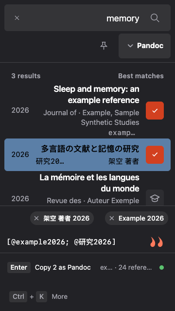 |
| linux · dark · larger-coarse-rtl · on |  | 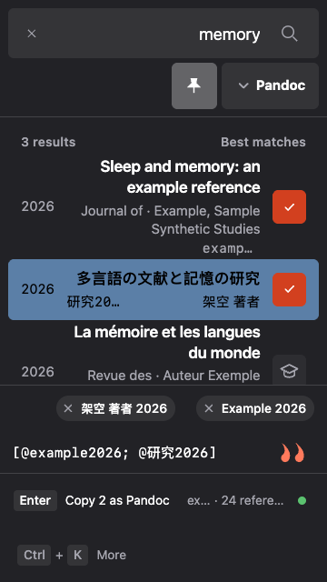 |

## Forced-color focus, selected

| macOS appearance | Windows appearance | Linux appearance |
| --- | --- | --- |
| 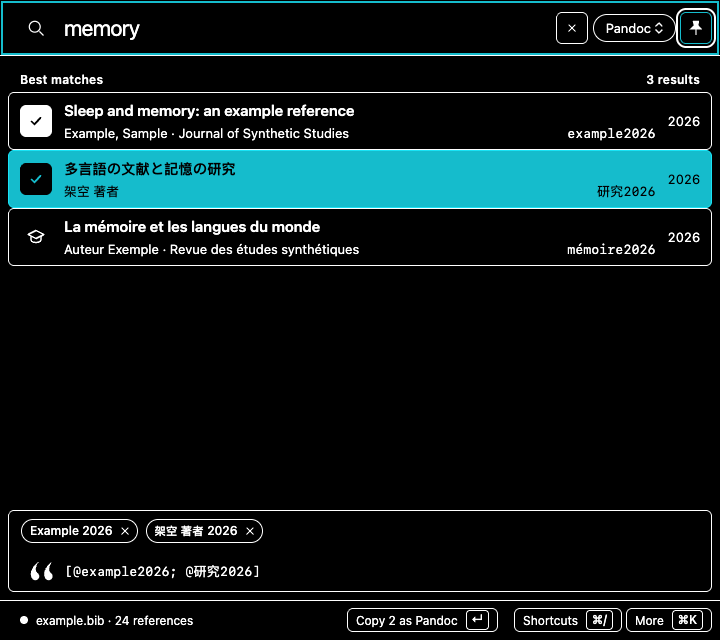 | 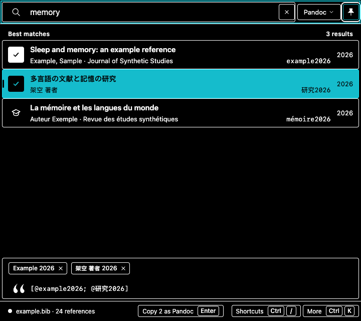 | 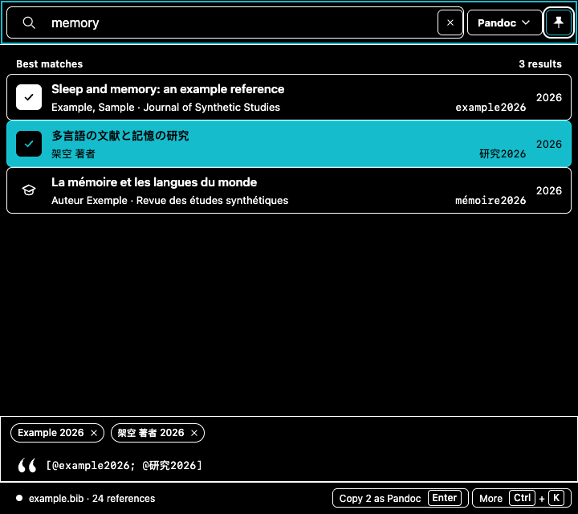 |
