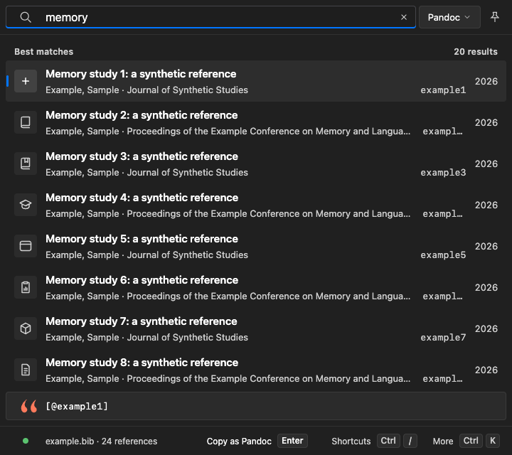

# Canvas C15 picker radius evidence

Synthetic browser renders, not native operating-system screenshots. Chrome on macOS, 720 × 640 CSS pixels; platform identity is set before page scripts load. These images do not certify the native window mask or shadow.

Candidate: `6f32f6fd62ee1f3606de29714f2d8d963cdbdf96` (PR #1011). Baseline runtime: merged main `b083465a0872acfb566021aa53476637503a96b2`; its retained evidence build was produced at `89c80ceb6dbae308bd2b70dda83e390b02247a97`, whose complete frontend source blobs were verified identical to that main. Both sides use actual builds, without reconstructed CSS.

## Computed checks

All 24 candidate cases passed for actual row, tile, field, pin/control, format popup, open menu, menu item and menu padding. Eighteen cases cover three looks × normal/Larger text × three densities (compact/comfortable light, spacious dark). Six additional Larger/dark cases cover RTL with coarse pointer and increased contrast or forced colours. Window values record the CSS role, not a measured native silhouette.

Six supplemental cases confirm the text setting actually changes the root from 16 to 18.4 px while radii stay fixed. Reinstating the former macOS popup-radius override in one private browser page makes the same computed-radius assertion fail; the injected rule is then removed. Layout spacing continues scaling; keycaps are unchanged. The unshipped citation-segment consumer remains C7.

Measurements: [matrix and frames](results.json), [actual text-scale confirmation](font-scale.json).

## Normal-text before / after

| Look | Light before | Light after | Dark before | Dark after |
|---|---|---|---|---|
| macOS |  |  |  |  |
| Windows |  |  |  |  |
| GNOME |  |  |  |  |
