# Explicit discovery on first run

Synthetic browser comparison for #998. Baseline: `b8b69e035391f8bcd954eec7ebe01ad4dd10d9b6`; candidate: `714f7693f829d0c6affed35f5d654cfa5250bebf`.

Chrome on macOS renders the named macOS, Windows and Linux appearance variants, selected before loading. These are browser screenshots, not native OS acceptance. The real App uses the existing first-run fixture and a controlled synthetic discovery promise. No protected folder, personal library, native command or permission setting is accessed.

The baseline starts one discovery call automatically and is captured while that promise is held pending. The candidate makes zero discovery calls and shows Find libraries. Choose library and Use Zotero remain usable immediately; neither starts discovery. Activating Find libraries explicitly starts one synthetic request. Repeated pointer/key presses while pending do not start another request, focus remains on the same control, and the synthetic mixed-script file appears after completion.

All 24 browser cases passed: three appearance variants × light/dark × normal-fine/Larger-coarse × baseline/candidate. Light comparison frames use 720 × 640 CSS pixels, normal text and LTR. Dark frames use 360 × 640, Larger text (1.15×), coarse-pointer/touch emulation and RTL. All labels and filenames are synthetic. These frames do not establish that macOS showed or suppressed an actual permission prompt; native acceptance is recorded separately.

| Appearance and view | Before, automatic discovery pending | Candidate, idle |
| --- | --- | --- |
| macos · light · normal-fine-ltr | 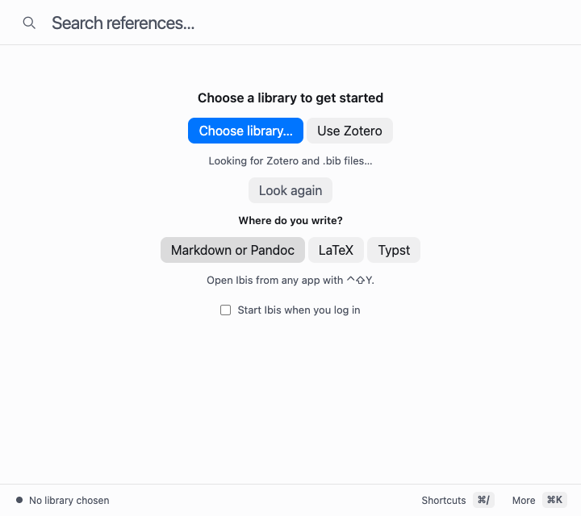 | 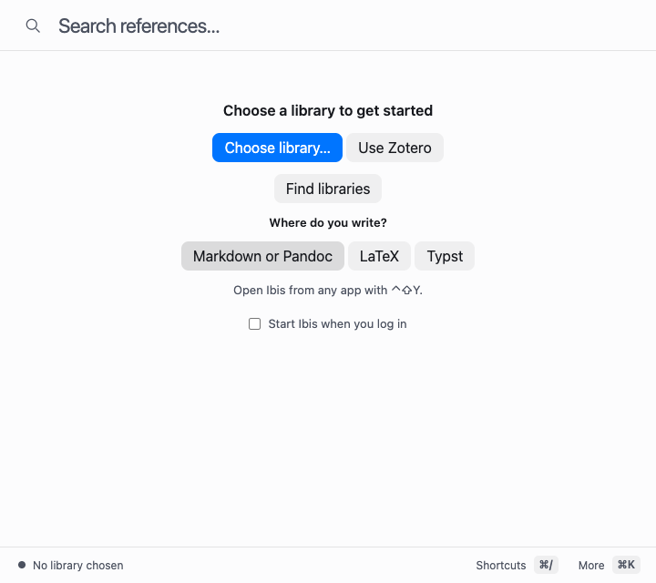 |
| macos · dark · larger-coarse-rtl | 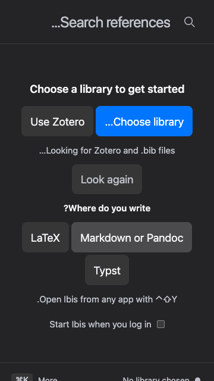 | 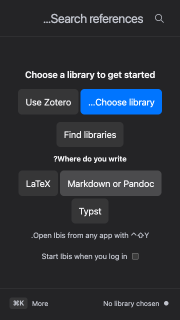 |
| windows · light · normal-fine-ltr | 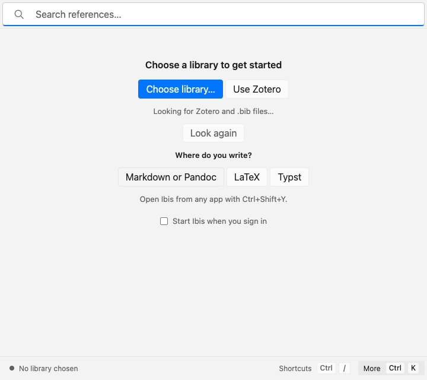 |  |
| windows · dark · larger-coarse-rtl | 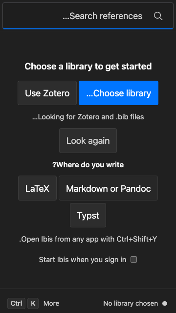 | 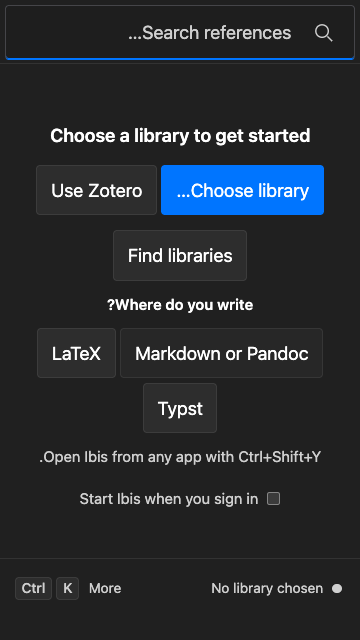 |
| linux · light · normal-fine-ltr | 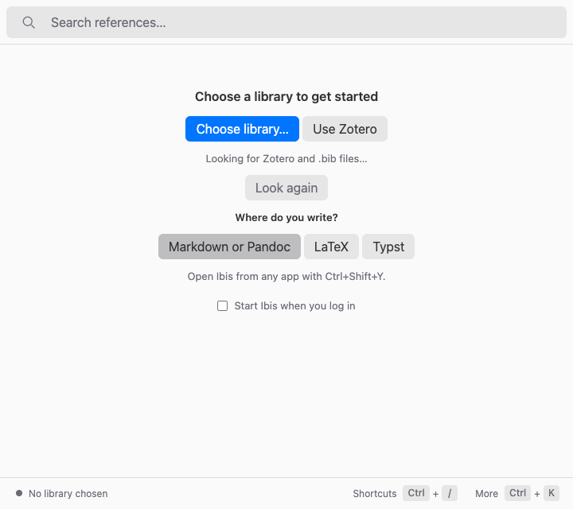 | 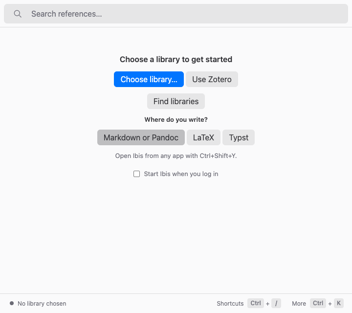 |
| linux · dark · larger-coarse-rtl | 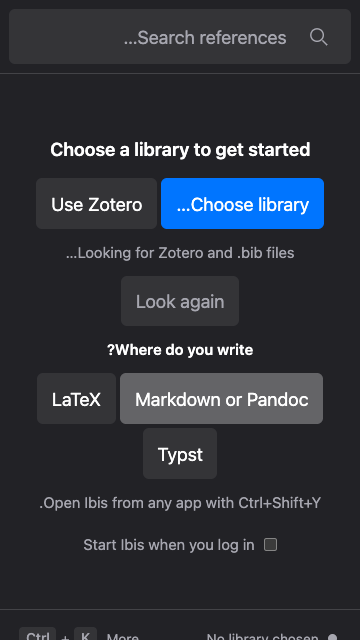 | 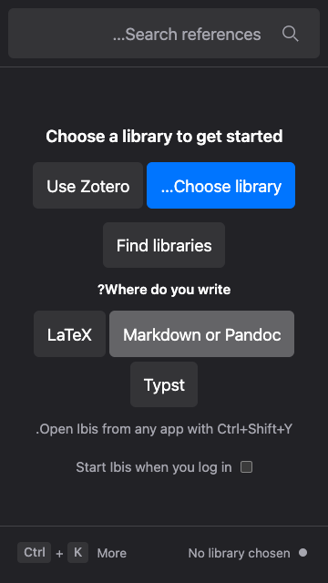 |
