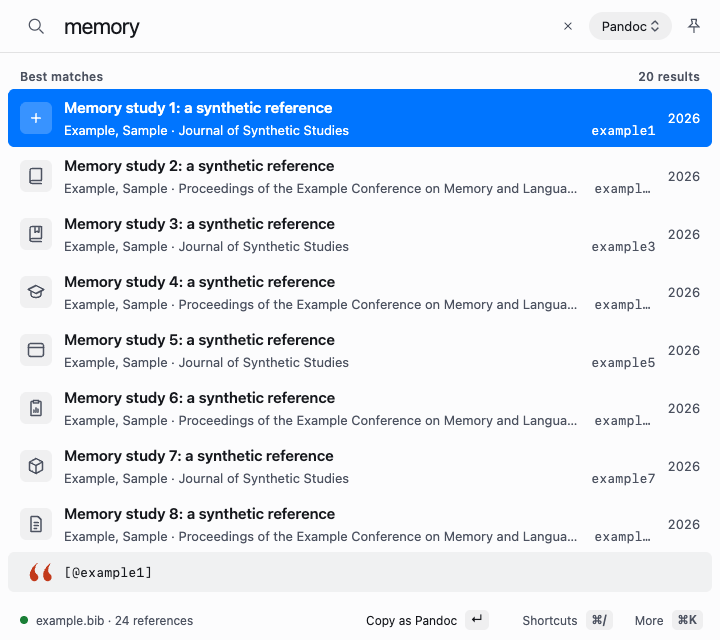
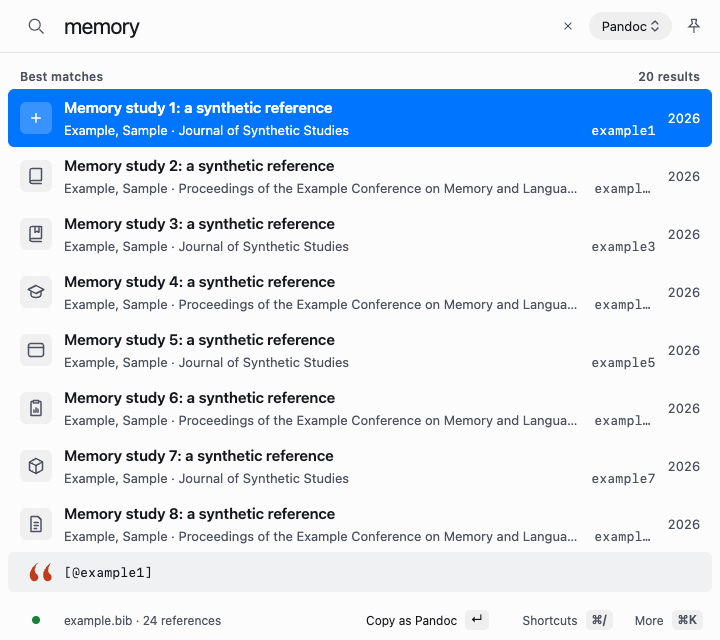
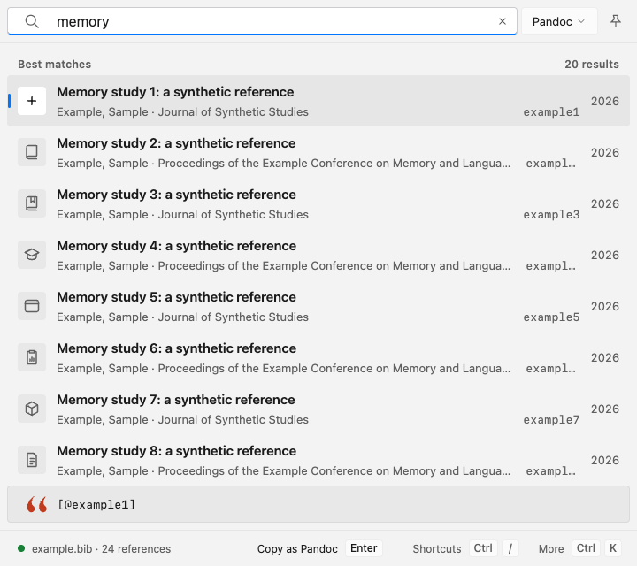
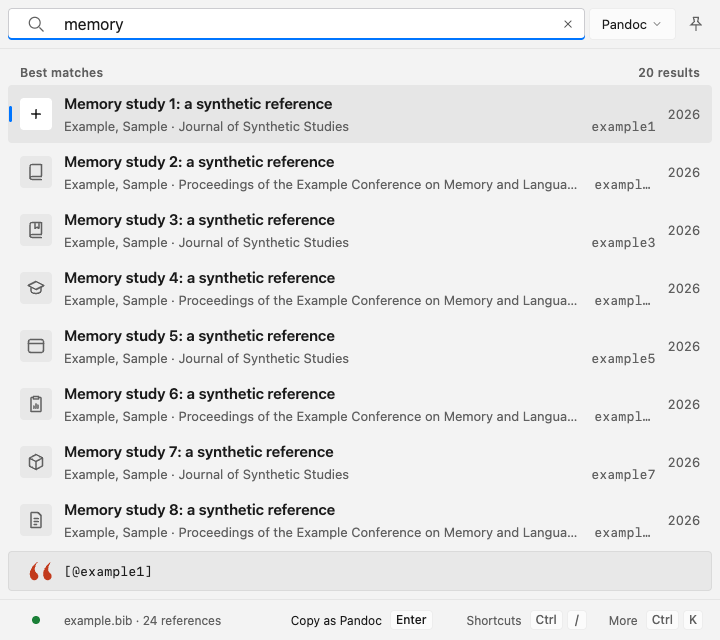
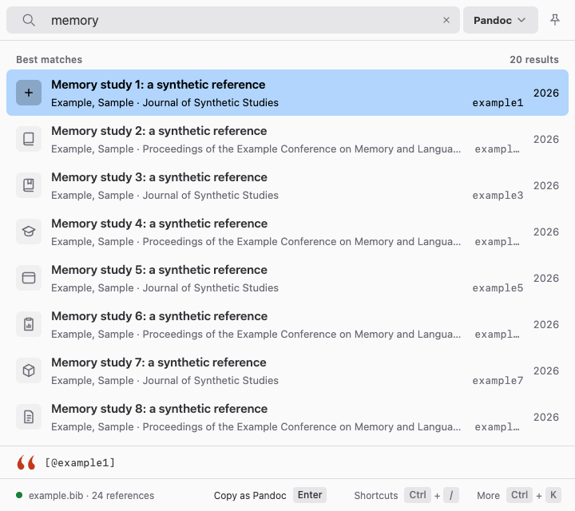
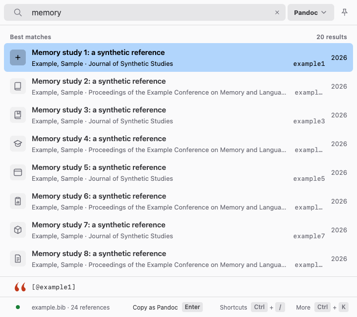
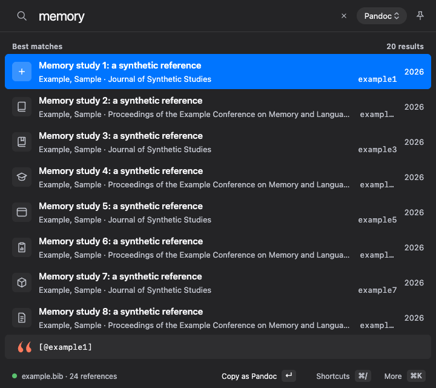
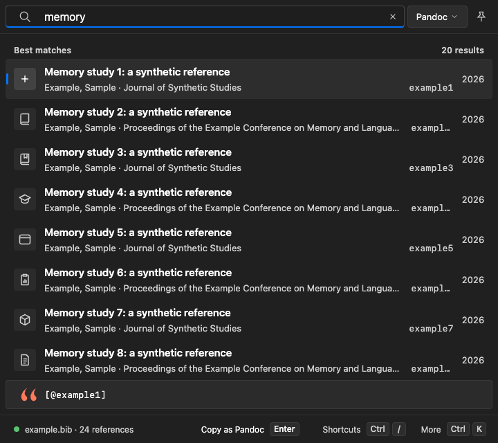
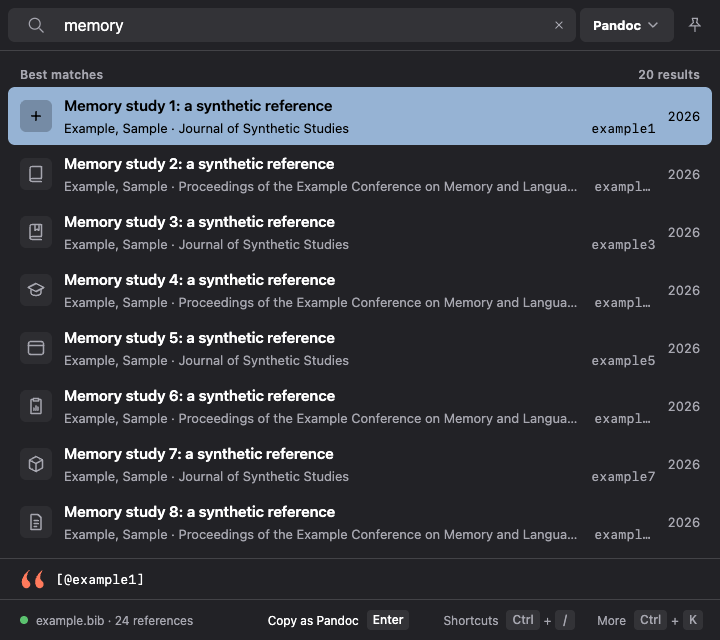
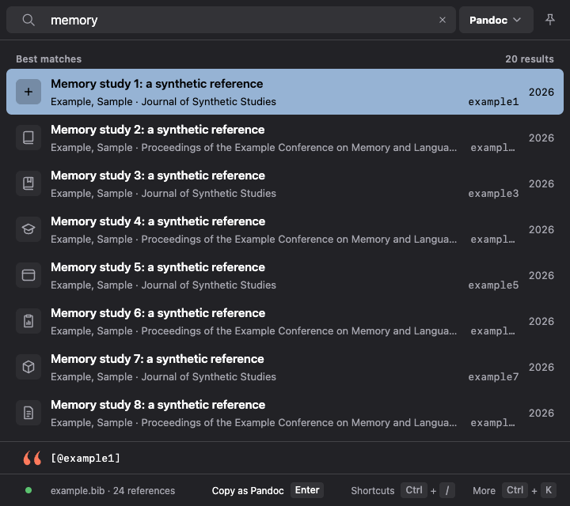

# C3 picker columns — browser evidence

Before: `d5b7388aa0fff6a8be8b8a392b1e461db70d8073` (actual baseline evidence build).
After: `89c80ceb6dbae308bd2b70dda83e390b02247a97` (actual candidate evidence build).

These are Chrome browser renders on macOS with synthetic references and platform-look emulation, **not native Windows/Linux/macOS captures**. Platform identity was set before loading. The paired frames use 720×640, normal text, LTR, light/dark themes and a resting pointer outside the controls.

| Look/theme | Before | After |
| --- | --- | --- |
| macos Light |  |  |
| windows Light |  |  |
| linux Light |  |  |
| macos Dark |  |  |
| windows Dark |  |  |
| linux Dark |  |  |

## Measurements and limits

The existing geometry checker measured 36 cases: three looks × normal/Larger text × LTR/RTL × Compact/Comfortable/Spacious. All 36 baseline cases fail the new absolute-column checks: status dot/text are 24/36 instead of 36/64; Windows citation text is 65 instead of 64, GNOME 56 instead of 64. All 36 candidate cases pass. Three additional normal-text dark cases pass on the candidate and retain the same baseline failures.

Twenty-four additional candidate cases cover Larger text in both directions across narrow fine/coarse pointers (360×800), dark appearance and Chromium forced colours (720×800). Every measured column passes; status and More do not overlap and the real More button owns its midpoint. Escape's existing deferred restoration is allowed to finish before Space reopens More; Tab then hands immediate typing to Search. The initial private probe omitted that restoration condition; no product change was made to pass it.

Coordinates are distances from the picker's logical start, using the existing bidi-isolated text boxes as layout anchors. They do not assert that every Latin glyph reads from an RTL edge. Absolute expected columns are 36/64 at normal size and 41.4/73.6 for Larger text; equal but misplaced pairs fail.

Recently added is not shipped yet; its future C11 consumer is not counted as verified. These results concern C3 columns and narrow footer ownership, not a blanket pass of the legacy radius specification (owned by C15/#943), native materials, OS focus, screen-reader speech or physical touch. The separate forced-colour frame follows keyboard probing and contains the synthetic query `memoryb`.

Machine-readable observations: [baseline](baseline.json), [candidate](candidate.json), [additional variants](adversarial.json), [dark baseline](baseline-dark.json), [dark candidate](candidate-dark.json). [Forced-colour Windows look](candidate-forced-windows.png).
