# Chip and result control comparison

Synthetic browser evidence for PR #997. Before: `afeb5f543d39b3d6f276620338f32942f906a679`; candidate: `c236397dde8e801e0a392c7892160660edc8131c`. Both versions render the existing synthetic many-results gallery fixture with Compact rows and one chosen citation. The clean main checkout served the baseline; the candidate checkout served the final commit.

Every frame is Chrome on macOS rendering the named Ibis appearance variant, selected before load. These are browser captures, not native OS screenshots. All titles, authors and filenames are synthetic. Search has focus and the pointer is outside the controls in the comparisons.

Light comparisons use 720 × 640 CSS pixels, normal text, fine pointer and LTR. Dark comparisons use 360 × 640, Larger text (1.15×), coarse-pointer/touch emulation and RTL. The final candidate centers 32/44 px targets (scaled with text) within each result row; coarse Compact rows reserve enough height to avoid target overlap. Resting artwork stays in place.

## Before and candidate

| Appearance and view | Before | Candidate |
| --- | --- | --- |
| macos · light · normal-fine-ltr | 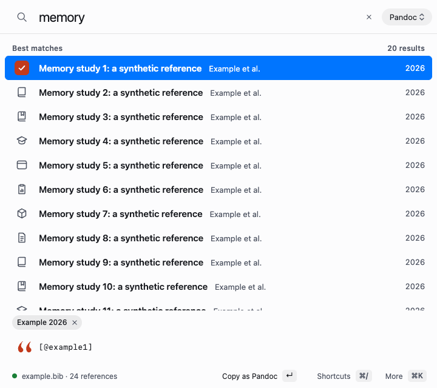 |  |
| macos · dark · larger-coarse-rtl | 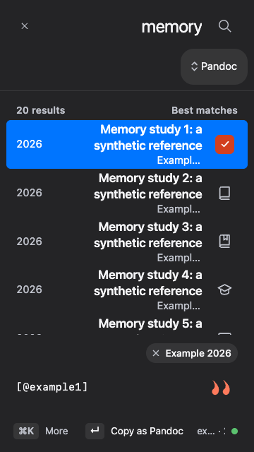 |  |
| windows · light · normal-fine-ltr |  | 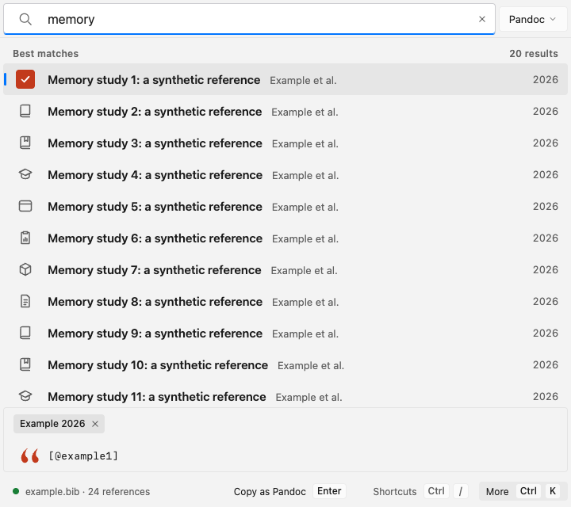 |
| windows · dark · larger-coarse-rtl | 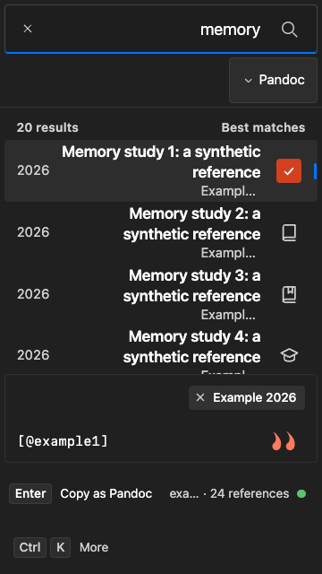 |  |
| linux · light · normal-fine-ltr | 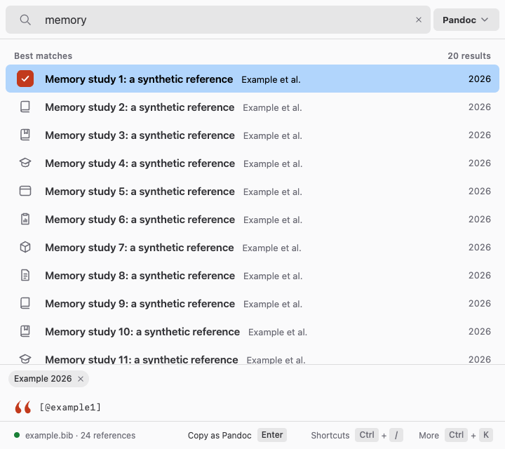 |  |
| linux · dark · larger-coarse-rtl | 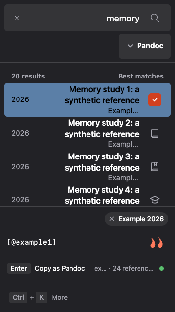 |  |

## Interaction and contrast evidence

All 78 browser acceptance cases passed on the final candidate: 36 tile geometry/interaction cases, 18 additional adversarial cases, 12 ChipGroup cases and 12 selected-check contrast cases. The accompanying JSON records the matrix and measurements.

Real pointer presses activated each target edge once without copying its row. Both long and two-pixel drag-outs cancelled without toggling, copying or hiding. Keyboard/IME takeover, query changes, actual scrolling and reopen cleared row and tile hover; still coordinates did not restore it. Stale-query tile clicks performed no action. Touch did not leave emulated hover. Chip tests retained opaque identities, RTL navigation, held-key safety and final-removal focus/typing.

Selected checks stayed visible through real hover and held press across all three looks, light/dark and forced colors. Computed, composited foreground/background pairs had a minimum 5.35:1 ratio. Forced-color frames show the held press; they do not establish native webview rendering. Windows/Linux manual interaction was not performed under the current SSH-and-CI direction.

| Appearance | Wrapped ChipGroup, Larger/coarse/RTL | Selected check, forced colors, held press |
| --- | --- | --- |
| macos |  | 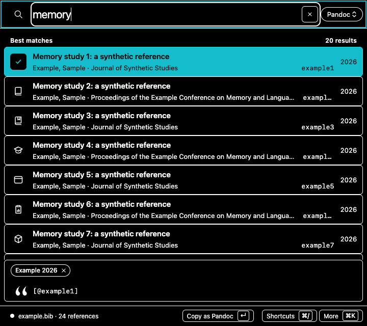 |
| windows | 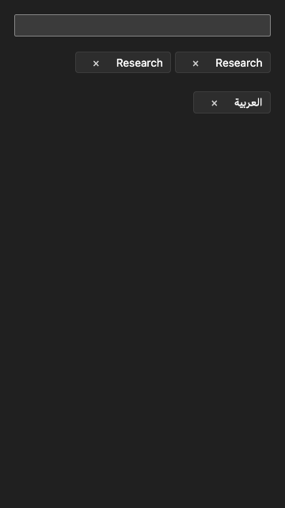 | 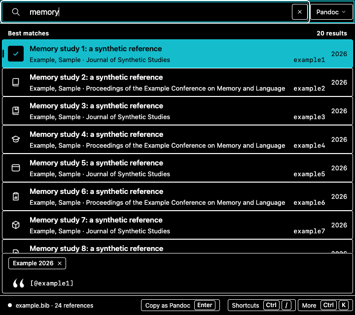 |
| linux | 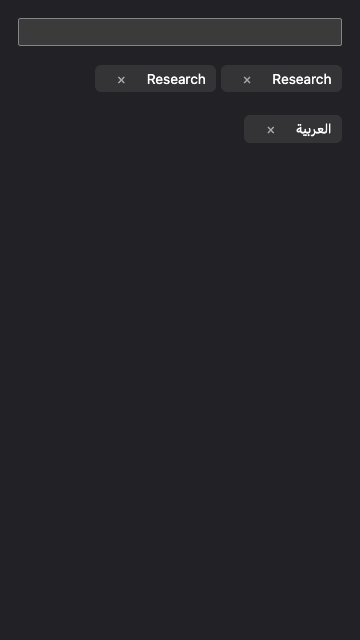 | 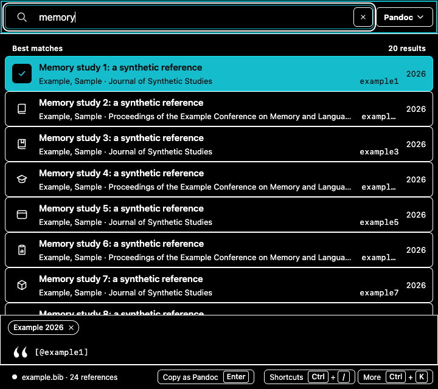 |
