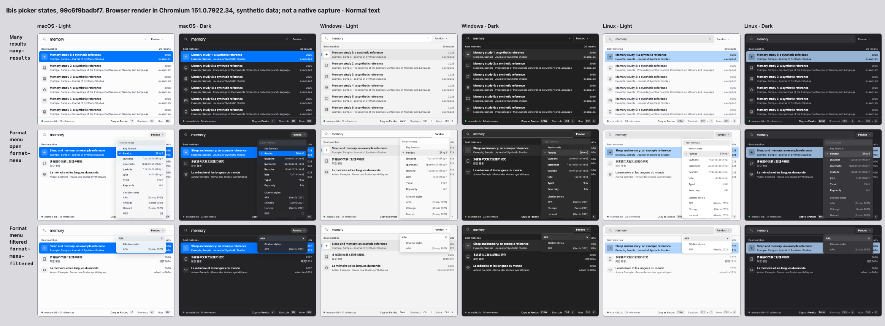

# Format menu — final browser evidence

Frozen source: `99c6f9badbf74cbe80a075624c1db97faa91f8a8`, based on actual main `3aec80b4`.

The one contact sheet uses `node scripts/gallery-contact-sheet.mjs`: closed/open/filtered Format states, three platform looks, light/dark, normal text. All eighteen synthetic Chromium frames were inspected. Citation styles are unavailable in this gallery because it provides no formatting engine. These are browser renders, not native materials or font acceptance.

The 42 Chromium routes, six WebKit focus routes and twelve narrow/200%/huge-Unicode checks passed at `91bf21fa`. Only a test file changed afterward; all production, style and gallery inputs are byte-identical at the final source. Cases cover picks, unavailable styles, IME, More Tab/Reload/Escape→Space, shortcuts, cancellation/replacement during genuine exit, and overlapping reopen. Rapid clicks are virtual activation after an observed exit, not a physical-pointer proof.

Both production builds passed with the same pinned dependencies: actual-main initial static JS graph gzip 138,150 → 145,258 bytes (+7,108), formatter worker unchanged.

A clean two-PR diagnostic merge preserves one generic command-test block, all five held-exit cases and the Format CSS case. It is not main; no pending peer commit is an ancestor of this branch. Root owns ordered normal queue integration. Full/review/hosted outcomes belong in the PR.

