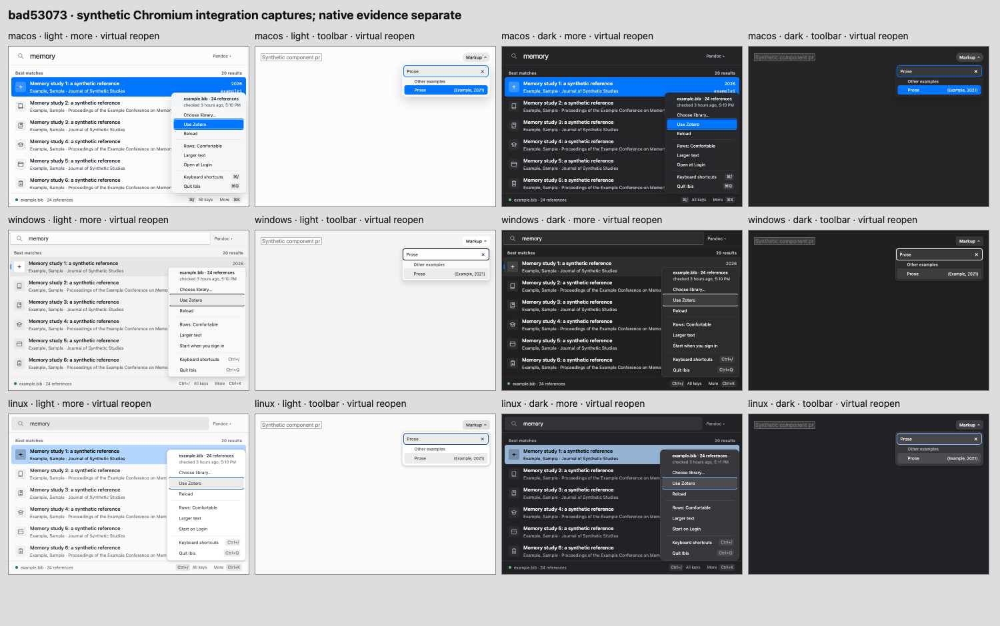

# Final menu integration — synthetic browser evidence

Final source: `bad53073995de43896d836cd0adad6a644c3351c`, integrated from actual main `30ea730b1fcdb35779049fe22748583f4e7af1ec`. Only the ten intended menu/test/adapter files differ from that main. Typed errors, preferences/operations hooks and the wrapped-footer spacing fix are preserved.

- **128 ordinary paths passed:** Chromium 151, three platform looks; WebKit 26.5, macOS look; both themes/motion preferences; real browser pointer and shortcut opening with Escape, Tab, Reload and shortcuts-dialog destinations. Escape returns More, Space reopens without editing the query, and Tab/action/dialog recovery returns Search and accepts typing. This matrix ran at `b0a5cc2df926abf7f015f4ba1c317c4c5ac71779`; final UI/Rust files are byte-identical, with only a smoke-helper follow-up afterward.
- **72 rapid lifecycle paths passed on the final source:** 48 More virtual/keyboard reopens plus 24 filtered-toolbar virtual reopens, three looks × both themes/motions × action/Escape close. Every case observed a committed `data-exiting` popover before reopening. The initial first-row strategy is checked before ArrowDown. Toolbar reopening accepts Prose filtering, navigation and Enter selection.
- Fast checks: all 431 default UI tests, TypeScript, gallery build and macOS HID contract pass. The delayed-Tab smoke regression fails before its five-second bounded wait and passes after; 101 contracts complete with 97 passes and four explicit platform/tool skips. The fresh exact-source guarded full was running when this evidence was published; its result belongs in the PR.

## Method qualifications

A same-task close/reopen initially batched into one open state and never exercised an exit. A DOM `.click()` is virtual activation: pinned React Aria intentionally marks the first row, so ArrowDown advances to the second. A real close click can also leave the physical cursor hovering the old row; an untrusted pointer replay is not a physical-input proof. The successful matrix therefore uses accurately labelled virtual/keyboard activation, checks initial focus explicitly, and does **not** claim a new physical rapid-pointer pass. The ordinary matrix separately covers real browser pointer input. These setup controls did not justify changing runtime code.

All images are synthetic Chromium browser renders, normal motion, captured after virtual action-close/reopen. More is shown after ArrowDown; the toolbar after typing Prose and ArrowDown, before Enter. PNG signatures, dimensions and hashes are recorded in [manifest.json](manifest.json). The contact sheet was inspected across all twelve frames.

[Prior actual macOS path and its strict limits](https://github.com/ibiscite/ibis/tree/6e470a14ed27c4b2ec2ecb93296c64682065f264/native/macos-menu-focus/2026-10-21/repair-dfe54536) remains separately source-qualified. No new native, physical rapid-pointer, reduced-motion OS, font/material or screen-reader acceptance is claimed here.
