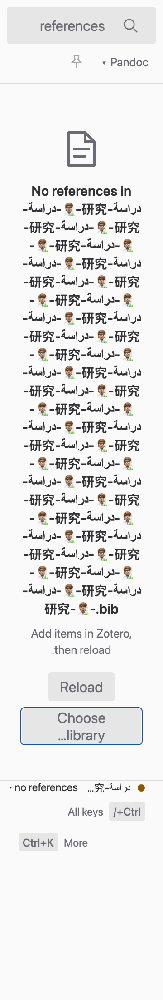
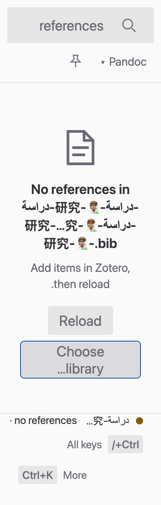

# Empty-library title adversarial audit — browser render

Source: `851a1cf00446e7798308faac88e0330ad891c5a6`; before: `e46da9bd854b95389553aec61a005a0f8515da68`.

The accepted template shortens unusually long filenames in the middle. A synthetic Arabic/CJK/emoji filename previously made the Linux-look title 1,240 px high at 360 px width and 200% system text. The repair caps visible names at 40 graphemes, preserving the end/extension, while exposing the full title to the accessibility tree. Missing snapshot labels have a meaningful fallback. Emoji and combining-mark regressions fail before and pass after.

All 96 Chromium profiles passed: three looks × light/dark × 720/360 × system text 100/200% × LTR/RTL × fine/coarse. The browser accessibility tree exposes the complete title. Recovery targets fit horizontally, meet 32/44 px minima without overlap, and pointer Reload plus keyboard Choose library each invoke their existing synthetic callback once. The paired Linux 360/200% RTL/coarse frames are full-page images: vertical scrolling remains intentional, and the last recovery action moves from y=1,952 to y=872. Full metrics and actual PNG metadata are in [audit.json](audit.json).

| Before | After |
| --- | --- |
|  |  |

Isolated EmptyState tests: 10 passed, the known idle KeyHint dependency explicitly excluded. TypeScript passed. An earlier incorrectly forwarded pnpm selection ran the whole UI suite and failed on that dependency plus the newly specified title cases; it is recorded in the PR and is not reported as a pass. No further idle-case retry occurs until the footer dependency lands. No full check or native acceptance is claimed; final idle hints, integration, captures and independent review remain pending.
