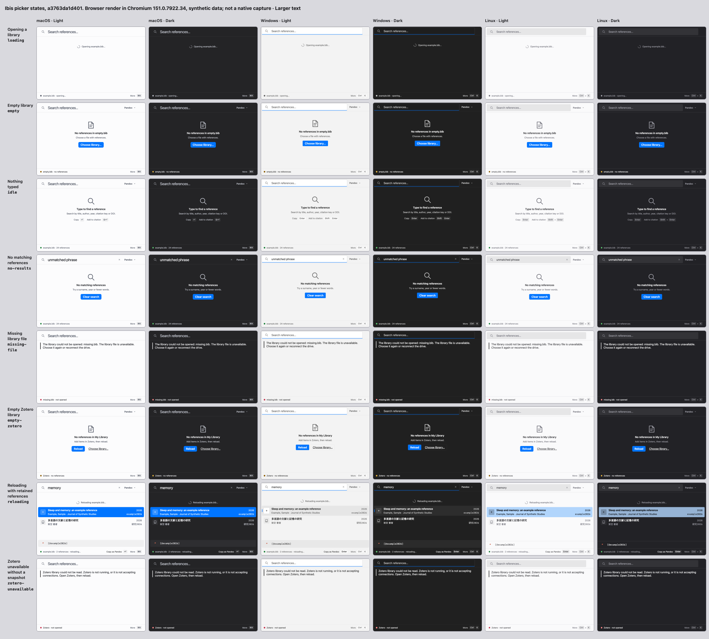

# Empty-state browser evidence

Source: `a3763da1d401e22b87aff20e4401b45497d71eb6`.
Actual-main baseline: `082db515d869f7a74cfee4df23824f3c7d0806e4`.

One evidence set, 96 synthetic frames: opening, empty file, idle, no matches,
missing file, empty Zotero, reloading with retained references, and unavailable
Zotero without a snapshot. Every state appears in macOS, Windows and Linux
browser looks, light/dark, normal and Larger text, at 720×480.
The existing scripts/gallery-contact-sheet.mjs rendered all 96 frames with
Chromium 151.0.7922.34. Both contact sheets were visually inspected.

Idle has its two decorative Copy/Add key hints and no action. Loading has only
a spinner and filename, without a description or chooser. Empty/no-match views
have a filled suggested action and quieter alternatives. Empty and unavailable
views have no results heading; reloading retains both rows beneath progress.
The header uses the landed Format menu and retained rows keep the CitationShelf.
Nonbusy titles and lines follow the named results list in DOM reading order;
busy progress stays before the retained rows.

The timer boundary, cancellation/restart, long multilingual filenames, full
accessible names and older-webview fallback are covered by interface tests.
Current final check, browser pressure results and independent review status
belong in PR #801's single evidence comment. This establishes browser layout;
native keyboard delivery, system materials and screen-reader speech are not
claimed by these screenshots.

