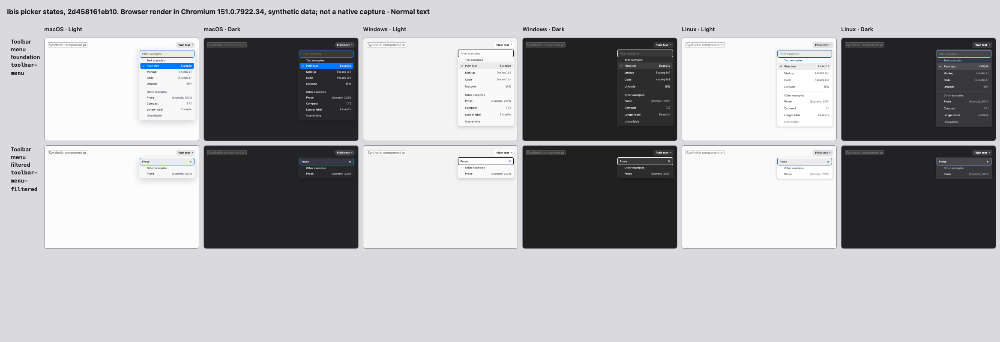

# Toolbar handoff integration

Source: `2d458161eb103391f9a697216fa69ade6948f370`, integrated from actual main `3aec80b4042fa248d4c70689d9b6b056b3c912c1` after #794 merged.

The one contact sheet comes from `node scripts/gallery-contact-sheet.mjs`: standalone toolbar open/filtered states, three platform looks, light/dark, normal text. All twelve synthetic Chromium frames were inspected. This is a browser render, not a native capture or a Format/App consumer. No appearance change is intended.

All 24 rapid lifecycle probes passed on this exact source: three platform looks × light/dark × normal/reduced motion × action/Escape close. Each observed a committed real `data-exiting` popover before virtual reopening, retained the same outer popover, restored filter focus, typed Prose, navigated/selected it, and returned focus after detachment. DOM clicks are virtual activation, not physical-pointer or native proof. Raw results record these qualifications.

The actual command/exit/cancellation paths, StrictMode and unmount/reopen coverage are exercised by the component tests. Full-check/review results belong in the PR. No manual native job was launched.

