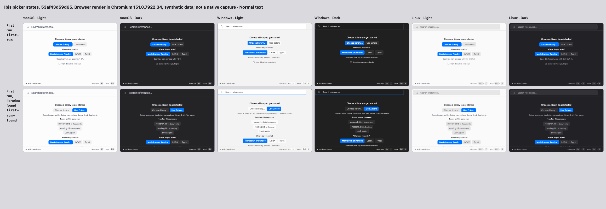

# First-run browser contact sheet

Source: `53af43d59d65af033938b494f6317fbcd0c8168f`.
Actual-main baseline: `3aec80b4042fa248d4c70689d9b6b056b3c912c1`.

One contact sheet, 12 synthetic frames: first-run and first-run-found,
three browser looks (macOS, Windows, Linux), light and dark, normal text,
720×480. Generated by the existing scripts/gallery-contact-sheet.mjs using
Chromium 151.0.7922.34. All frames rendered and were visually inspected.

Choose library is the suggested action by default; Use Zotero is suggested
when the synthetic discovery reports it available. Writing selection uses a
fill. The duplicate header format control and first-run section heading are
absent. The two offered files are synthetic, not paths from a real computer.

Six additional browser-only checks used coarse input, 200% text and widths
360/720 across all three looks: no horizontal overflow; the Typst selection
keeps a distinct fill and remains hit-test reachable after keyboard focus;
the suggested library action remains scroll-reachable and clickable. All six
passed. No second contact sheet or native run was produced.

Final check and independent exact-head review status belong in PR #822's one
current evidence comment. This sheet claims no native keyboard delivery,
system material or screen-reader speech acceptance.

