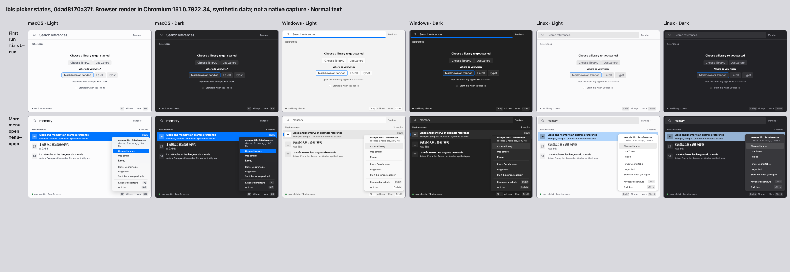
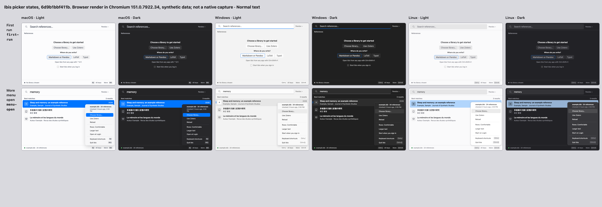

# Login wording — PR #734

Synthetic browser renders in Chromium 151.0.7922.34, 720 × 480, normal text.
Each set covers `menu-open` and `first-run` across macOS, Windows and Linux looks,
in light and dark. The contact sheets label the source commit and browser.

- Before: main `0dad8170a37faea541d9dfbb78b7af0ac8ac5c86`.
- After: PR head `6d9b1bbf411b1ecba6301e60256f41b201299973`.
- Capture command: the repository's `scripts/gallery-contact-sheet.mjs` with
  `--state menu-open --state first-run --text normal`.
- 24 individual frames plus two labelled contact sheets; no failed frames.
- `png-manifest.json` records actual PNG byte validation, dimensions and SHA-256.

## Before

## After

The More item changes from “Start Ibis when you log in” to “Open at Login” on
macOS, “Start when you sign in” on Windows and “Start on Login” on Linux.
The Windows first-run checkbox changes to “Start Ibis when you sign in”; the
other first-run checkboxes keep “log in”. All labels are visible without clipping.

These are browser renders, not native captures. Native menu-bar/tray items and
problem notices are not shown; native behavior was not exercised. Gallery key
labels remain outside this partial change in #581. Larger text was not captured;
normal text covers this wording comparison.
